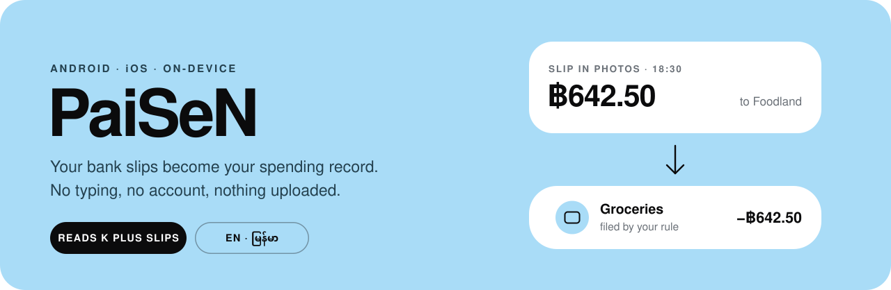
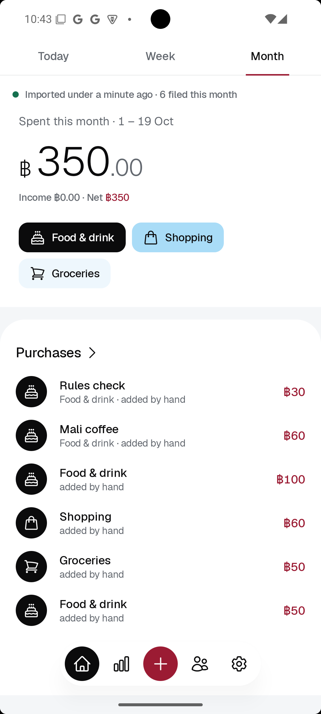
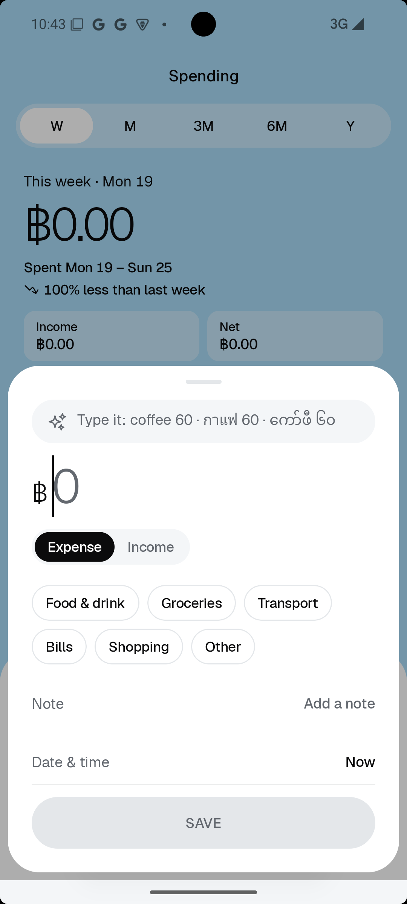
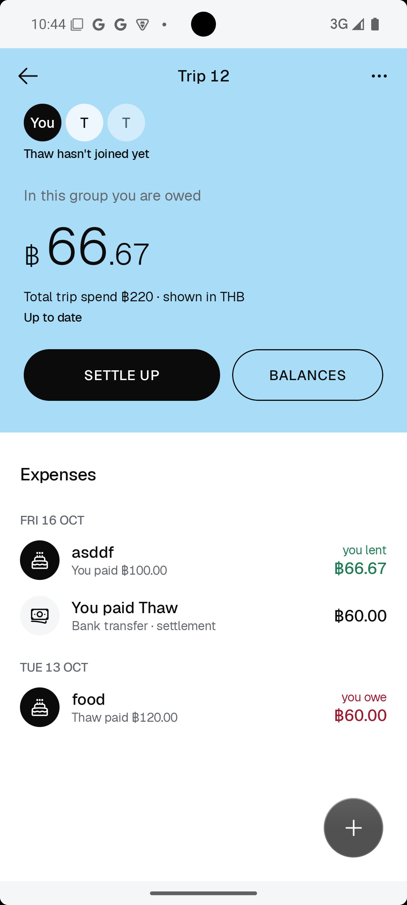
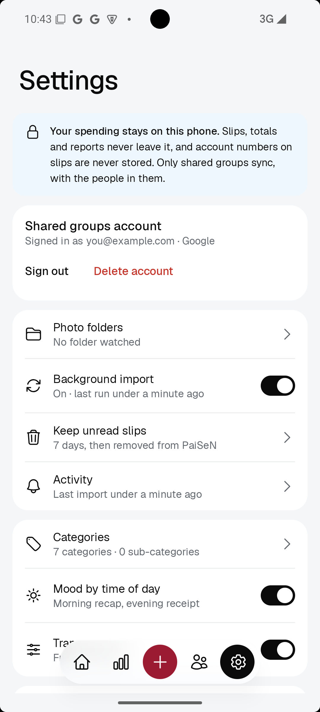
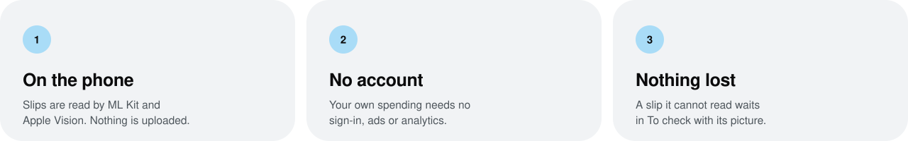
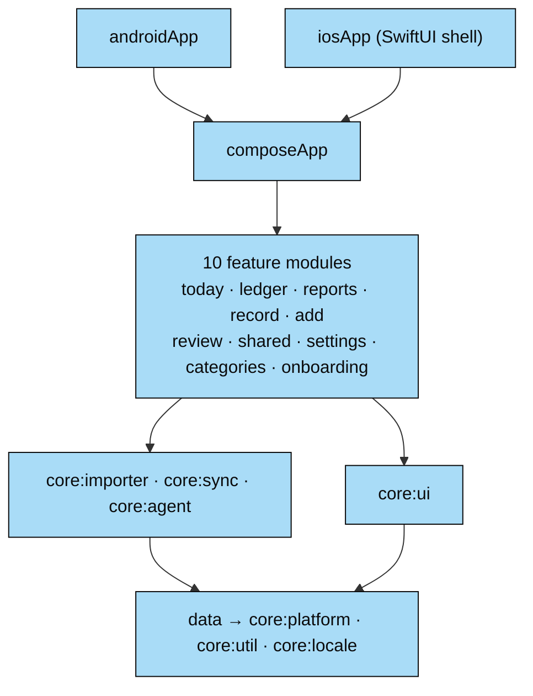

<p align="center">
  
</p>

<p align="center">
  
</p>

<p align="center">
  <a href="https://github.com/thawzintoe-ptut/PaiSen/actions/workflows/ci.yml"></a>
  <a href="LICENSE"></a>
  
  
  
  
</p>

<h3 align="center">
  <a href="#features">Features</a> ·
  <a href="#privacy">Privacy</a> ·
  <a href="#architecture">Architecture</a> ·
  <a href="#build-it-yourself">Build</a> ·
  <a href="CONTRIBUTING.md">Contributing</a>
</h3>

<table>
  <tr>
    <td align="center"><br>Home</td>
    <td align="center"><br>Reports</td>
    <td align="center"><br>Quick add</td>
  </tr>
  <tr>
    <td align="center"><br>Shared</td>
    <td align="center"><br>A shared group</td>
    <td align="center"><br>Settings</td>
  </tr>
</table>

## Why PaiSeN

In Thailand, a QR payment or a transfer usually ends with a slip saved to your photos. PaiSeN reads
those slips and turns them into a record of where your money went.

<p align="center">
  
</p>

## Features

<table>
  <tr><td><b>Slips become transactions</b></td><td>Reads K PLUS slips from your photos — amount, shop or person, date and transaction id. ML Kit and Apple Vision read on the phone.</td></tr>
  <tr><td><b>It learns your shops</b></td><td>Pick a category for a shop once; the next slip from that shop gets the same one.</td></tr>
  <tr><td><b>To check</b></td><td>A slip it cannot read waits with its picture, so you can fix it by hand.</td></tr>
  <tr><td><b>Today, week, month</b></td><td>What you spent, your top categories, and how today compares with a usual day.</td></tr>
  <tr><td><b>Reports</b></td><td>3 months, 6 months or a year, by category and sub-category.</td></tr>
  <tr><td><b>Quick add</b></td><td>Type or say “coffee 60” in English, Thai or Burmese.</td></tr>
  <tr><td><b>Shared groups (optional)</b></td><td>Split a bill or a trip. Join by link or QR, settle up with a PromptPay QR.</td></tr>
  <tr><td><b>Your file</b></td><td>Export the whole record and import it on a new phone.</td></tr>
  <tr><td><b>English and မြန်မာ</b></td><td>Burmese digits included, in light and dark.</td></tr>
</table>

## Privacy

> [!NOTE]
> Your own spending, slips and reports never leave the phone. No ads, no analytics, no crash
> reporting — and Android and iCloud backups of the app's data are turned off.

Only shared groups use the network, and only after you sign in to share. Everything that is sent,
and where, is in [PRIVACY.md](PRIVACY.md).

#### CI checks these promises on every push

- [x] No analytics or crash-reporting SDK, and no HTTP client except the one shared groups use
- [x] Network code only inside the sync module
- [x] No telemetry upload service in the merged Android manifest
- [x] No account number in the slip test data

## Architecture

One Kotlin Multiplatform codebase. The UI is Compose Multiplatform on both platforms; only what
must be native is written per platform.



<details>
<summary><b>Stack</b></summary>
<br>

The module layout follows [android/architecture-samples](https://github.com/android/architecture-samples).

- Feature modules never depend on each other. CI fails if a feature reaches past the repositories
  into Room.
- `data` holds the Room database and the repositories. Money is stored as whole satang, never as a
  floating-point number.
- `core:importer` is the slip pipeline: read the photo, parse the text, apply the shop rules.
- `core:sync` is the only module that talks to the network.

| Area | Tools |
|---|---|
| UI | Compose Multiplatform, Material 3, the Geist typeface |
| Storage | Room (KMP) with bundled SQLite |
| Dependency injection | Koin |
| Slip reading | ML Kit Text Recognition (Android), Apple Vision (iOS) |
| Shared groups | Firebase Auth and Firestore over REST with Ktor, Firebase Cloud Messaging |
| Push delivery | A Cloudflare Worker in [`firebase/push-worker`](firebase/push-worker) |
| Security rules | Firestore rules tested against the emulator in [`firebase/rules-test`](firebase/rules-test) |
| Quality | Spotless, custom Gradle checks, host tests on Android and the iOS simulator |

</details>

## Install

**Android.** Download `PaiSeN-<version>.apk` from [Releases](https://github.com/thawzintoe-ptut/paisen/releases)
and open it on the phone.

**iPhone, without the App Store.** Each release also has `PaiSeN-<version>.ipa`. It is not signed,
so you sign it with your own Apple ID in [SideStore](https://sidestore.io) or
[AltStore](https://altstore.io):

1. Set up SideStore on the iPhone with its own guide. It needs a computer once.
2. On the iPhone, download the `.ipa` from [Releases](https://github.com/thawzintoe-ptut/paisen/releases).
3. In SideStore, open **My Apps**, tap **+** and pick the file.
4. Open SideStore at least once a week and tap **Refresh All**. A free Apple ID signs an app for 7
   days, and after that PaiSeN won't open until you refresh. Your data stays on the phone.

A free Apple ID can't sign Sign in with Apple, push notifications or links that open an app. So in
this build those three don't work, and an invite link opens in Safari. A free Apple ID can also
keep only 3 sideloaded apps at a time.

## Build it yourself

You need JDK 17 and Android Studio — and on a Mac, Xcode for the iOS app.

```bash
git clone https://github.com/thawzintoe-ptut/PaiSen.git
cd PaiSen
git config core.hooksPath .githooks
```

> [!TIP]
> **Shared groups** stay off until you connect your own
> [Firebase project](firebase/README.md) — everything else works without it.

<details>
<summary><b>Run it on Android or iOS, and run the tests</b></summary>
<br>

**Android**

```bash
./gradlew :androidApp:installDebug
```

**iOS.** Xcode copies `GoogleService-Info.plist` into the app, and the real one is not in the repo.
An empty file is enough to build:

```bash
plutil -create xml1 iosApp/iosApp/GoogleService-Info.plist
```

Then open `iosApp/iosApp.xcodeproj` in Xcode and run the `iosApp` scheme. The build phase runs
Gradle for the Kotlin framework.

**Tests**

```bash
./gradlew spotlessCheck testAndroidHostTest
./gradlew iosSimulatorArm64Test
```

</details>

## License

PaiSeN is free software under the [GNU General Public License v3.0](LICENSE). Copyright © 2026
Thaw Zin Toe.

> [!IMPORTANT]
> The license covers the code, not the name **PaiSeN** or its icon. If you publish your own build or a
> fork, give it a different name and icon.
