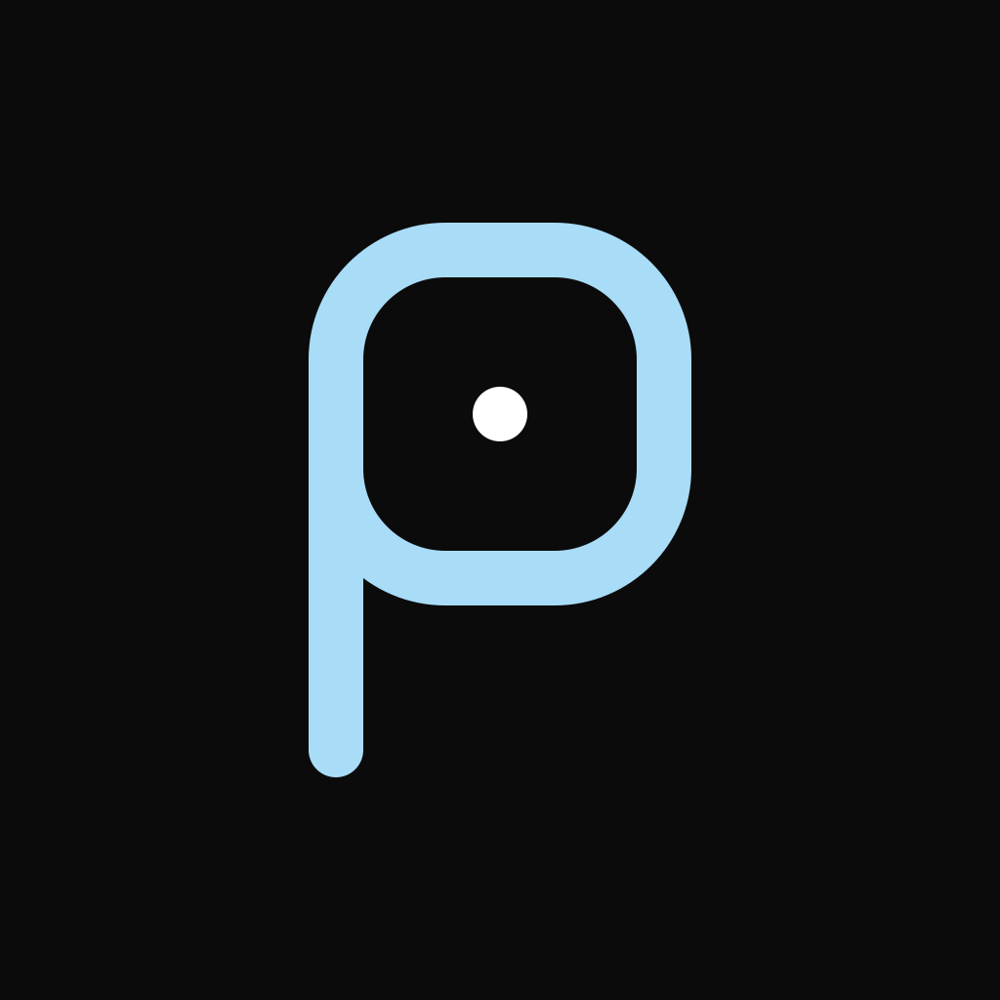
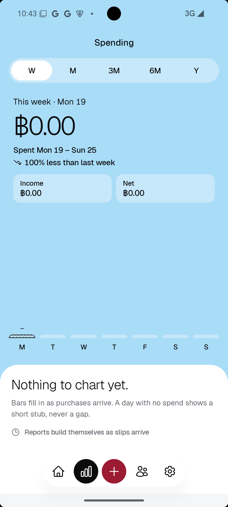
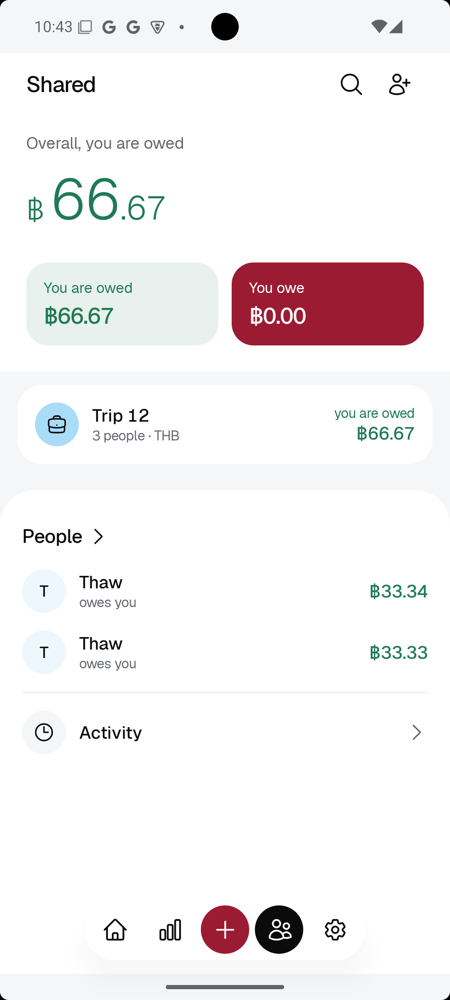
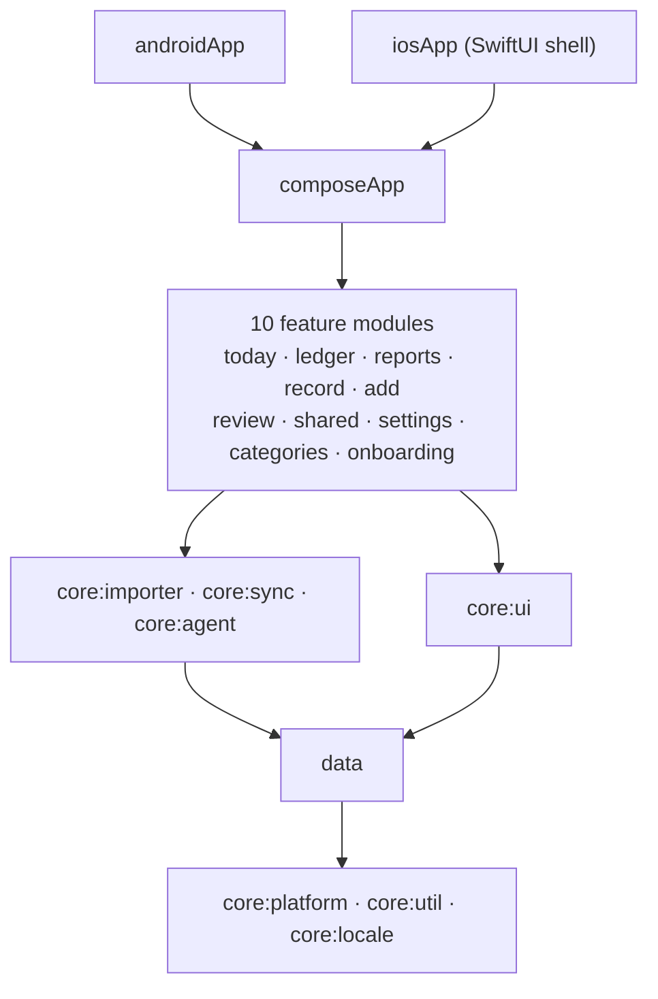

<p align="center">
  
</p>

<h1 align="center">PaiSeN</h1>

<p align="center">
  An expense tracker for Android and iOS that reads your bank slips on the phone<br>
  and keeps your spending there.
</p>

<p align="center">
  <a href="https://github.com/thawzintoe-ptut/PaiSen/actions/workflows/ci.yml"></a>
  <a href="LICENSE"></a>
  
  
  
  
</p>

<!--
  Screenshots: put 4 or 5 real phone screenshots in docs/screenshots/ (Today, To check, Reports,
  a shared group, Settings), light and dark, then replace this comment with a row like:

  <p align="center">
    
    
    
    
  </p>
-->

## Why PaiSeN

In Thailand, a QR payment or a transfer usually ends with a slip saved to your photos. PaiSeN reads
those slips and turns them into a record of where your money went. You do not type anything,
nothing is uploaded, and you need no account.

## Features

- **Slips become transactions.** PaiSeN reads K PLUS payment slips from your photos. It finds
  the amount, the shop or person, the date and the transaction id. ML Kit (Android)
  and Apple Vision (iOS) do the reading on the phone.
- **It learns your shops.** Pick a category for a shop once, and the next slip from that shop
  gets the same one. The record shows which rule filed it.
- **Nothing is lost.** A slip it cannot read waits in *To check* with its picture, so you can fix
  it by hand.
- **Today, week and month.** See what you spent today, this week and this month, your top
  categories, and how today compares with a usual day.
- **Reports** for 3 months, 6 months and a year, by category and sub-category.
- **Quick add.** Type or say an expense, like "coffee 60", in English, Thai or Burmese. Speech is
  recognised on the phone. On iOS, Siri and the icon's shortcuts open a filled-in sheet.
- **Shared groups (optional).** Split a bill with one person or a trip with a group. Members join
  from a link or a QR code, see the same balances, and are told when something changes.
  Settle up with a PromptPay QR that opens your bank app.
- **Your data, your file.** Export the whole ledger to a file and import it on a new phone.
- **English and Burmese**, with Burmese digits, in light and dark.

## Privacy

Your own spending, slips and reports never leave the phone. There are no ads, no analytics and no
crash reporting, and the app turns off Android and iCloud backups of its data.

Only shared groups use the network, and only after you sign in to share. The full list of what is
sent, and where, is in [PRIVACY.md](PRIVACY.md).

CI checks these promises on every push:

- no analytics or crash-reporting SDK, and no HTTP client except the one shared groups use
- network code only inside the sync module
- no telemetry upload service in the merged Android manifest (ML Kit's uploader is removed)
- no account number in the slip test data

The slip reader on Android uses ML Kit's bundled model, so nothing is downloaded the first time
you scan.

## Architecture

PaiSeN is one Kotlin Multiplatform codebase. The UI is Compose Multiplatform on both platforms, and
only the parts that must be native (photo library, text recognition, speech, sign-in, push) are
written per platform. The module layout follows
[android/architecture-samples](https://github.com/android/architecture-samples).



- Feature modules never depend on each other. CI fails if a feature reaches past the repositories
  into Room.
- `data` holds the Room database and the repositories. Money is stored as whole satang, never as a
  floating-point number.
- `core:importer` is the slip pipeline: read the photo, parse the text, apply the shop rules.
- `core:sync` is the only module that talks to the network.

| Area | Tools |
|---|---|
| UI | Compose Multiplatform, Material 3, the Geist typeface |
| Storage | Room (KMP) with bundled SQLite |
| Dependency injection | Koin |
| Slip reading | ML Kit Text Recognition (Android), Apple Vision (iOS) |
| Shared groups | Firebase Auth and Firestore over REST with Ktor, Firebase Cloud Messaging |
| Push delivery | A Cloudflare Worker in [`firebase/push-worker`](firebase/push-worker) |
| Security rules | Firestore rules tested against the emulator in [`firebase/rules-test`](firebase/rules-test) |
| Quality | Spotless, custom Gradle checks, host tests on Android and the iOS simulator |

## Build it yourself

You need JDK 17, Android Studio, and on a Mac, Xcode for the iOS app.

```bash
git clone https://github.com/thawzintoe-ptut/PaiSen.git
cd PaiSen
git config core.hooksPath .githooks
```

**Android**

```bash
./gradlew :androidApp:installDebug
```

**iOS.** Xcode copies `GoogleService-Info.plist` into the app, and the real one is not in the repo.
An empty file is enough to build:

```bash
plutil -create xml1 iosApp/iosApp/GoogleService-Info.plist
```

Then open `iosApp/iosApp.xcodeproj` in Xcode and run the `iosApp` scheme. The build phase runs
Gradle for the Kotlin framework.

**Tests**

```bash
./gradlew spotlessCheck testAndroidHostTest
./gradlew iosSimulatorArm64Test
```

**Shared groups** are off until you connect your own Firebase project. Without it, the app builds
and runs, and everything else works. To turn them on, copy `firebase.properties.example` to
`firebase.properties` and follow [firebase/README.md](firebase/README.md).

## Contributing

This is a personal project, but bug reports and ideas are welcome in
[Issues](https://github.com/thawzintoe-ptut/PaiSen/issues). Please open an issue before you start
a pull request, so we can agree on the change first. Report security problems privately, as
[SECURITY.md](SECURITY.md) describes.

PaiSeN uses trunk-based development: short branches, pull requests into `main`, and releases
tagged on `main`. [CONTRIBUTING.md](CONTRIBUTING.md) has the branch rules, the checks and the
commit format.

## License

Copyright © 2026 Thaw Zin Toe

PaiSeN is free software: you can redistribute it and change it under the terms of the
[GNU General Public License v3.0](LICENSE). If you ship a changed version, you must share its
source code under the same license.

**Name and icon.** The license covers the code. It does not give you the right to use the name
PaiSeN or its icon. If you publish your own build or a fork, give it a different name and icon so
nobody confuses it with this app.

**Third-party code and assets** keep their own licenses:

- [Geist and Geist Mono](https://github.com/vercel/geist-font), SIL Open Font License 1.1
- [Heroicons](https://github.com/tailwindlabs/heroicons), MIT
- The Zawgyi detector in `core/agent` is ported from
  [google/myanmar-tools](https://github.com/google/myanmar-tools), Apache License 2.0
